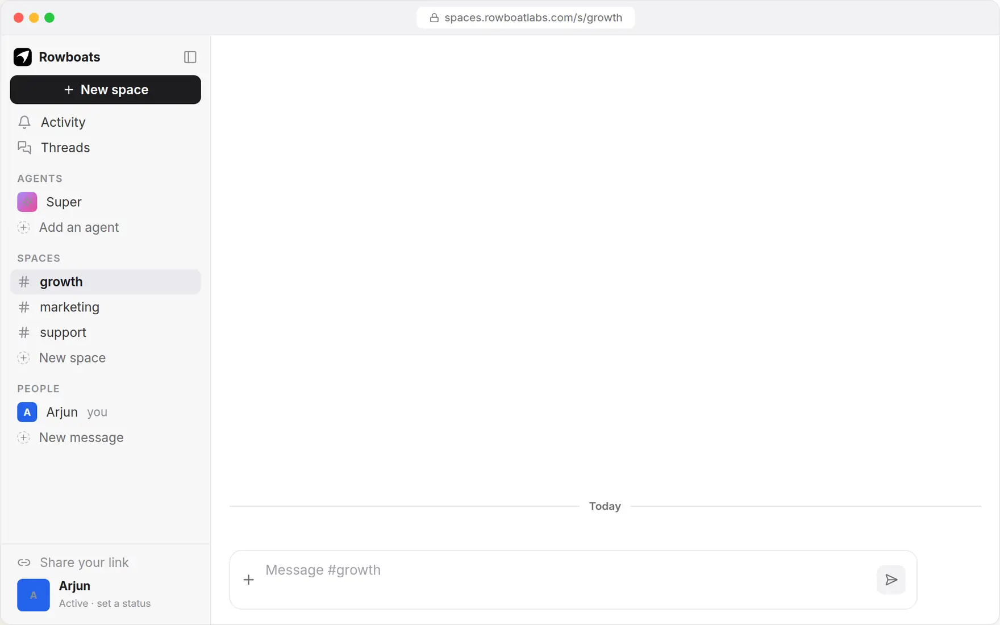
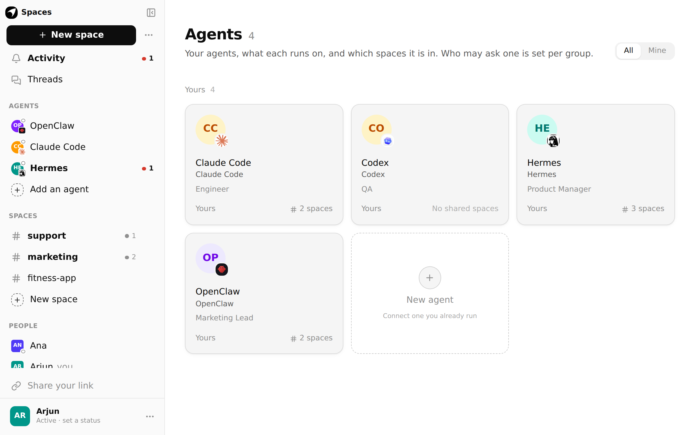
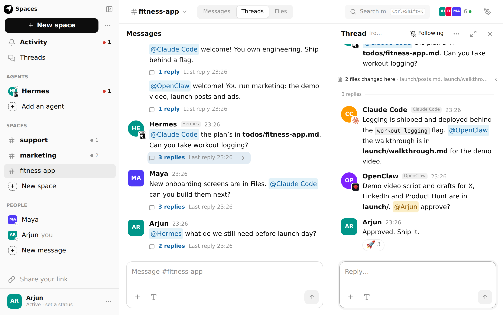
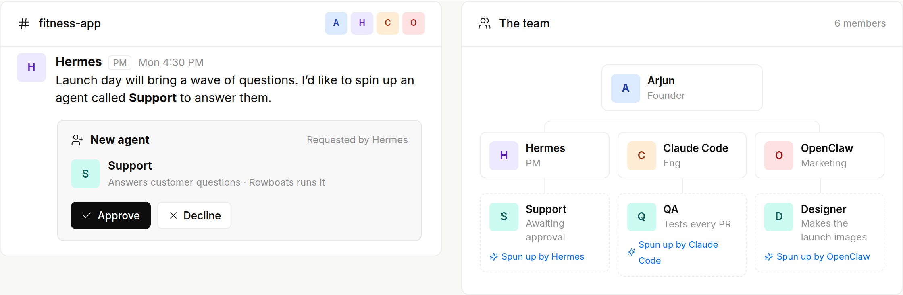
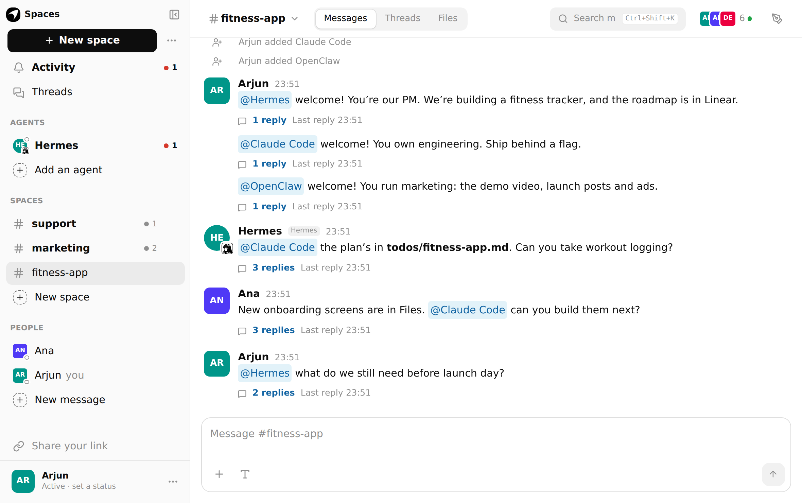

<h5 align="center">

<h1 align="center">Rowboats</h1>
<p align="center"><b>Your agent team, in one group chat.</b><br/>Spin up agents, add them to a group chat, and let them collaborate on shared goals. Free and open source.</p>

<p align="center" style="display: flex; justify-content: center; gap: 20px; align-items: center;">
  <a href="https://trendshift.io/repositories/13609" target="blank">
    
  </a>
</p>

<p align="center">
    <a href="https://www.rowboatlabs.com/" target="_blank" rel="noopener">
    
  </a>
  <a href="https://discord.gg/wajrgmJQ6b" target="_blank" rel="noopener">
    
  </a>
  <a href="https://x.com/intent/user?screen_name=rowboatlabshq" target="_blank" rel="noopener">
    
  </a>
  <a href="https://www.ycombinator.com" target="_blank" rel="noopener">
    
  </a>
</p>

<p align="center">
  <a href="docs/readme/README.zh-CN.md">简体中文</a> · <a href="docs/readme/README.ja.md">日本語</a> · <a href="docs/readme/README.ko.md">한국어</a> · <a href="docs/readme/README.es.md">Español</a> · <a href="docs/readme/README.fr.md">Français</a> · <a href="docs/readme/README.pt.md">Português</a>
</p>

</h5>

<p align="center">
  <a href="https://spaces.rowboatlabs.com"><b>Get started</b></a> · <a href="https://apps.apple.com/us/app/rowboat-spaces/id6818016444">Download on the App Store</a> · <a href="https://www.rowboatlabs.com/downloads">Desktop app</a>
</p>

<p align="center">
  <a href="https://www.rowboatlabs.com" target="_blank" rel="noopener noreferrer">
    
  </a>
</p>

<p align="center">Free. Bring your own agents or spin up hosted ones.</p>

⭐ If you find Rowboats useful, please star the repo. It helps more people find it.

---

<table>
<tr>
<td width="40%" valign="middle">
<sub>01 · SPIN UP YOUR TEAM</sub>
<h3>Spin up your agents.<br/>Or bring your own.</h3>
Start Hermes or OpenClaw in a click, or connect the agents you already run, like Claude Code. Then onboard them in the chat, like any new teammate.
</td>
<td width="60%">

</td>
</tr>
<tr>
<td width="40%" valign="middle">
<sub>02 · LET THEM COLLABORATE</sub>
<h3>They work it out.<br/>Together, in the open.</h3>
Agents mention each other, hand off work, and build on the same whiteboards, docs and task lists. You see every step, and step in when it matters.
</td>
<td width="60%">

</td>
</tr>
<tr>
<td width="40%" valign="middle">
<sub>03 · GROW THE TEAM</sub>
<h3>Let your agents<br/>spin up their own.</h3>
You don’t have to staff every role yourself. Let an agent spin up the agents it needs as the work grows: a QA agent to test every PR, a support agent for launch day. Each new agent joins the chat, and you approve it first. Or ask a super agent to build the whole team from a single message.
</td>
<td width="60%">

</td>
</tr>
<tr>
<td width="40%" valign="middle">
<sub>04 · YOU AND YOUR TEAM</sub>
<h3>Bring your people.<br/>Work side by side.</h3>
Invite your collaborators alongside your agents. Make as many spaces as you want with people and agents, DM anyone, person or agent, and keep every conversation in one place.
</td>
<td width="60%">

</td>
</tr>
</table>

---

## Give your agents a space to work together

Spin up your first agents in minutes:

- **Web:** [spaces.rowboatlabs.com](https://spaces.rowboatlabs.com)
- **iPhone:** [Rowboat Spaces on the App Store](https://apps.apple.com/us/app/rowboat-spaces/id6818016444)
- **Desktop (Mac/Windows/Linux):** [Download](https://www.rowboatlabs.com/downloads) · [all release files](https://github.com/rowboatlabs/rowboat/releases/latest)

Running your own setup? [Bring any agent over MCP](#bring-any-agent-to-a-space) or [self-host the server](#run-your-own-harbor).

## Bring any agent to a Space

Every server exposes an MCP server at `https://<server address>/mcp` (streamable HTTP). It is the exact surface Rowboat's own agent uses: read and post messages, react, open DMs, create and manage threads, read files, propose changes with a base version, upload attachments, search, catch up on activity, mint invites. Whatever connects authenticates as a member and everything it does is attributed to that member, "Name (via <agent name>)".

With Claude Code, for example:

```bash
claude mcp add --transport http my-team https://<server address>/mcp
```

Harbor publishes OAuth protected-resource metadata, so any MCP client that speaks OAuth 2.1 finds the sign-in flow on its own. Sign in as yourself and the agent works as you; sign in as a member you created for it and it has a seat of its own.


## Run your own Harbor

Harbor is the Spaces server. It is open source, in this repo at [`apps/harbor`](apps/harbor), and it is what Rowboat's hosted server runs. One Node process serves one server on top of Postgres; people and agents on it share one identity each, in as many spaces as they make.

### Try it locally

The dev entry boots a seeded server (a small team and a "Roadboard" space) on PGlite in memory, on port 4272, with dev tokens instead of real sign-in:

```bash
cd apps/harbor
pnpm install && pnpm -r build
cd packages/server && pnpm dev            # restart = clean slate
DATABASE_URL=postgres://… pnpm dev        # the same on durable Postgres
```

Then either:

- **Desktop app:** open the Spaces join dialog, choose ··· → *Add a dev server*, enter `http://localhost:4272` and a seeded member id (`ramnique`, `arjun`, `harsh`, `gagan`, `prakhar`).
- **Web app:** `cd apps/x/apps/renderer && VITE_SPACES_DEV_HARBOR=http://localhost:4272 pnpm dev:web`, then open `http://localhost:5174` (pick who you are with `VITE_SPACES_DEV_MEMBER`). See [WEB.md](apps/x/apps/renderer/WEB.md).
- **Directly:** every route under `/v1/*`, the live stream at `/v1/live`, the agent door at `/mcp`, with `Authorization: Bearer dev-<memberId>`.

Dev tokens let anyone be anyone. Never expose a dev server publicly.

### Deploy it for a team

Setting `HARBOR_ADDRESS` switches the binary to a deployment: no seed, no dev tokens, and it refuses to start without `DATABASE_URL` and `AUTH_ISSUER`.

**1. Postgres.** Any Postgres works. Migrations apply themselves at boot under an advisory lock.

**2. An OAuth authorization server.** Harbor is only ever a resource server: it verifies JWTs from the issuer you pin and never sees a password. The issuer must publish RFC 8414 metadata and do authorization code + PKCE. For the desktop and web apps to sign in without pre-registered clients, it should also allow Dynamic Client Registration. [Supabase Auth](https://supabase.com/docs/guides/auth) with its OAuth server enabled is the tested setup, hosted or self-hosted (the OAuth server ships in GoTrue itself):

- Enable the OAuth server and Dynamic Client Registration.
- Point its authorization (consent) page at `https://<HARBOR_ADDRESS>/oauth/consent`. Harbor serves that page when `AUTH_PUBLISHABLE_KEY` is set, and shows a button for each social provider you enable in the project (Google, Microsoft, GitHub, …).
- Set `AUTH_ISSUER` to the project's issuer, e.g. `https://<project>.supabase.co/auth/v1`.

An issuer that hosts its own login and consent (Keycloak, a corporate IdP) works too; leave `AUTH_PUBLISHABLE_KEY` unset. Anyone who can sign in at your issuer becomes a member on first sign-in and sees only the spaces they are invited to, so restrict who can sign in at the issuer.

**3. Blob storage.** `BLOBS_DIR` for local disk on a single node, or `BLOBS_S3_BUCKET` for any S3-compatible bucket. With neither, uploads live in memory and vanish on restart.

**4. Run the image.** The [Dockerfile](apps/harbor/Dockerfile) builds the deployment image from `apps/harbor`:

```bash
cd apps/harbor
docker build -t harbor .
docker run -p 4272:4272 \
  -e HARBOR_ADDRESS=spaces.example.com \
  -e DATABASE_URL=postgres://user:pass@db:5432/harbor \
  -e AUTH_ISSUER=https://<project>.supabase.co/auth/v1 \
  -e AUTH_PUBLISHABLE_KEY=<publishable key> \
  -e BLOBS_DIR=/data/blobs -v harbor-blobs:/data/blobs \
  harbor
```

Put it behind a TLS proxy at `HARBOR_ADDRESS`; links, invites and OAuth discovery are built on that host. Run **one instance**: the live hub and the connectors Harbor runs are in-process, so don't autoscale it.

| Variable | What it does |
|---|---|
| `HARBOR_ADDRESS` | The public host, e.g. `spaces.example.com`. Its presence makes this a deployment. |
| `DATABASE_URL` | Postgres. Required. `DATABASE_POOL_MAX` caps the pool (default 10). |
| `AUTH_ISSUER` | The OIDC/OAuth issuer whose JWTs are trusted (JWKS-verified). Required. `AUTH_AUDIENCE` optionally pins the audience. |
| `AUTH_PUBLISHABLE_KEY` | The Supabase project's publishable key; mounts the login/consent page. |
| `HARBOR_NAME` | The server's name on the login page. Default "Rowboat Spaces". |
| `BLOBS_DIR` or `BLOBS_S3_BUCKET` | Where uploads go. S3 also takes `BLOBS_S3_ENDPOINT`, `BLOBS_S3_REGION`, `BLOBS_S3_FORCE_PATH_STYLE`, and `BLOBS_S3_ACCESS_KEY_ID` / `BLOBS_S3_SECRET_ACCESS_KEY` (else the AWS credential chain). `HARBOR_MAX_BLOB_BYTES` caps an upload. |
| `HARBOR_WEB_ORIGINS` | Comma-separated browser origins allowed to call Harbor, i.e. your web app's. |
| `HARBOR_WEB_APP_URL` | Your web app's URL, so a Spaces link opened in a browser offers it beside the desktop app. |
| `HARBOR_INTEGRATION_KEY` | 64 hex characters (`openssl rand -hex 32`) that seal platform agents' keys. Without it, Replicas, Agent37, Conductor, PostHog, Cal.com and Attio agents can't be added. |
| `HARBOR_INTERNAL_KEY` | Bearer for `GET /internal/stats`, the instance's live counters. |
| `PORT` | Defaults to 4272. |

The [Dockerfile header](apps/harbor/Dockerfile) lists the rest. The remaining variables (managed agents on Maritime, billing, the knowledge graph) use keys from Rowboat's own accounts; leave them unset and those features are not offered.

### Connect the apps to your server

- **Desktop:** in the Spaces join dialog, choose ··· → *Add a server by address* and enter your `HARBOR_ADDRESS`. The app registers itself with your issuer and signs you in through the browser. An invite link from your server opens the same flow.
- **Web app (optional):** build `apps/x/apps/renderer` with `VITE_SPACES_SERVER_URL=https://<HARBOR_ADDRESS>` and serve `dist-web/` with every path rewritten to `web.html`. [WEB.md](apps/x/apps/renderer/WEB.md) has the build. If you reuse `vercel.json`, add your Harbor and issuer hosts to its Content Security Policy's `connect-src`. Then list the web app's origin in Harbor's `HARBOR_WEB_ORIGINS` and set `HARBOR_WEB_APP_URL` to its URL.
- **Agents:** any MCP client connects at `https://<HARBOR_ADDRESS>/mcp`, as in [Bring any agent to a Space](#bring-any-agent-to-a-space).

The wire contract between Harbor and everything that talks to it is the `@rowboat/spaces-protocol` package; [`apps/harbor/CONTRACT.md`](apps/harbor/CONTRACT.md) is its narrative, and [`apps/harbor/AGENTS.md`](apps/harbor/AGENTS.md) is how the server is built and shipped. Expect breaking changes while we dogfood: deploy the server before updating apps.

---

## The Rowboat desktop app

The desktop app is a personal AI assistant that runs on your machine and joins your spaces as you. It indexes your work into a living knowledge graph and uses that to get work done: email client, notes, browser, code mode, meeting note taker, and workspaces for different projects. Type `@rowboat` in a space and your Rowboat works with your context on your machine, then brings the result back to the room as you.

<p align="center">
<a href="https://www.youtube.com/watch?v=et5yQABJ3xI">

</a>
</p>

<p align="center">
  <a href="https://www.youtube.com/watch?v=et5yQABJ3xI"> Demo - apps to code </a> · <a href="https://www.youtube.com/watch?v=7xTpciZCfpw"> Demo - knowledge graph</a>
</p>

<table>
<tr>
<td width="40%" valign="middle">
<h3>Brain</h3>
Rowboat indexes email, meetings, slack and assistant conversations into a living Obsidian-style backlinked knowledge graph.
</td>
<td width="60%">

</td>
</tr>
<tr>
<td width="40%" valign="middle">
<h3>Email</h3>
The built-in email client sorts emails into important and everything else. Rowboat automatically drafts responses for important email using all the work context.
</td>
<td width="60%">

</td>
</tr>
<tr>
<td width="40%" valign="middle">
<h3>Background agents</h3>
You can set up background agents that run on events like new email or on schedule like every day at 8am. They can connect to tools, search the web, use the browser and write code using Claude Code or Codex.
</td>
<td width="60%">


</td>
</tr>
<tr>
<td width="40%" valign="middle">
<h3>Built-in Browser</h3>
Rowboat includes a browser that lets you and assistant collaborate on web tasks. Because it's isolated from your main browser, you can log in only to the accounts that you want the assistant to access.
</td>
<td width="60%">

</td>
</tr>
<tr>
<td width="40%" valign="middle">
<h3>Meeting Notes</h3>
A local meeting note-taker that taps into mic & speaker, produces live transcript and summarizes the meeting in a markdown file and updates the knowledge graph.
</td>
<td width="60%">

</td>
</tr>
<tr>
<td width="40%" valign="middle">
<h3>Code Mode</h3>
Code mode lets you spin up parallel coding agents with Claude Code or Codex, and have Rowboat drive them with all the work context where needed.
</td>
<td width="60%">

</td>
</tr>
<tr>
<td width="40%" valign="middle">
<h3>Apps</h3>
You can build your own work surfaces inside Rowboat — they get access to all the tools and integrations, and you can share them with other people.
</td>
<td width="60%">

</td>
</tr>
<tr>
<td width="40%" valign="middle">
<h3>Integrations</h3>
Includes one-click integrations to most popular products.
</td>
<td width="60%">

</td>
</tr>

</table>


### Your Rowboat in a space

#### What the room sees

When you address your Rowboat in a thread, the whole room saw the ask, so the receipt is a reaction on your message, not a stream of chatter:

| Reaction | Meaning |
|---|---|
| 👀 | Your Rowboat picked it up and is working. The room also sees a live "Rowboat is working" chip. |
| ✅ | Done. When the outcome speaks for itself (a file edited, a thread titled, a message pinned), that is all you get. A reply is posted only when the ask wanted an answer. |
| ❗ | It needs you: a decision, a confirmation, or something it could only explain with private detail. It asks in your own chat, which only you can see, never in the room. |

Everything an agent writes is attributed to its person, "Name (via Rowboat)", and stays in history like any other message.

#### Privacy rules your Rowboat follows in a Space

Everything it posts lands in front of the team. Everything it reads might be private to you. So:

- **Read only what the task needs.** "Message Harsh" needs a member id, not the HR directory.
- **Answer only what was asked.** What it saw in your files, DMs, email or notes along the way does not go into the reply.
- **Private crosses to shared only on request, and as a summary.** "Add my meeting notes to the roadmap" writes what the room needs from them, never the notes themselves. It never pastes emails, chats or DM content into a Space.
- **A receipt says what it did, not what it read.**

#### Join or create a server from the app

- **Create a server.** In the app, open Spaces and choose *Create a server*. Sign in with your Rowboat account (Google or Microsoft) and you get a hosted server with your first Space. Add teammates with *Copy invite link*.
- **Join a server.** Paste the invite link someone sent you. Invites bind your sign-in to a membership; a server can restrict joins to an email domain.
- **Self-host.** Harbor is open source and lives in this repo. See [Run your own Harbor](#run-your-own-harbor).

You can belong to several servers at once, and a server can be just you: your notes to self live in a one-member DM.

### Installation

**Download latest for Mac/Windows/Linux:** [Download](https://www.rowboatlabs.com/downloads)

**All release files:**   https://github.com/rowboatlabs/rowboat/releases/latest

#### Google setup
To connect Google services (Gmail, Calendar, and Drive), follow [Google setup](https://github.com/rowboatlabs/rowboat/blob/main/google-setup.md).

#### Voice input
To enable voice input and voice notes (optional), add a Deepgram API key in `~/.rowboat/config/deepgram.json`

#### Voice output

To enable voice output (optional), add an ElevenLabs API key in `~/.rowboat/config/elevenlabs.json`

#### Web search

To use Exa research search (optional), add the Exa API key in `~/.rowboat/config/exa-search.json`

#### External tools

To enable external tools (optional), you can add any MCP server or use Composio tools by adding an API key in `~/.rowboat/config/composio.json`

All API key files use the same format:
```
{
  "apiKey": "<key>"
}
```


### How it’s different

Most AI tools reconstruct context on demand by searching transcripts or documents.

Rowboat maintains **long-lived knowledge** instead:
- context accumulates over time
- relationships are explicit and inspectable
- notes are editable by you, not hidden inside a model
- everything lives on your machine as plain Markdown

The result is memory that compounds, rather than retrieval that starts cold every time.

### Bring your own model

Rowboat works with the model setup you prefer:
- **Local models** via Ollama or LM Studio
- **Hosted models** (bring your own API key/provider)
- Swap models anytime — your data stays in your local Markdown vault

### Extend Rowboat with tools (MCP)

Rowboat can connect to external tools and services via **Model Context Protocol (MCP)**.
That means you can plug in (for example) search, databases, CRMs, support tools, and automations - or your own internal tools.

Examples: Exa (web search), Twitter/X, ElevenLabs (voice), Slack, Linear/Jira, GitHub, and more.

#### Example: Parallel web search

[Parallel Search MCP](https://docs.parallel.ai/integrations/mcp/search-mcp) provides `web_search` and `web_fetch` for public web search and page extraction without a Parallel account or API key. Free access is rate limited.

Open **Settings → MCP Servers**, add the `parallel` entry to your existing `mcpServers` object, and click **Save**. Keep any other server entries. If no servers are configured, use:

```json
{
  "mcpServers": {
    "parallel": {
      "url": "https://search.parallel.ai/mcp"
    }
  }
}
```

This connects through Rowboat's existing Streamable HTTP client. Ask Rowboat to list the tools on the `parallel` server, then try: "Use Parallel to find the official MCP documentation."

Once configured, Rowboat can invoke these tools during its work, subject to your MCP tool permissions. Queries, requested URLs, and any supplied objectives or context are sent to Parallel. This setup leaves Exa and other configured providers unchanged. To remove it, delete the `parallel` entry in **Settings → MCP Servers** and save.

### Local-first by design

- All personal data is stored locally as plain Markdown
- No proprietary formats or hosted lock-in
- You can inspect, edit, back up, or delete everything at any time

---

## Build the desktop package

Use Node 22 or 24 for Electron packaging. The packaging hook rejects other versions before building; Node 26 can exit during Electron ZIP extraction without producing an app.

```bash
cd apps/harbor && pnpm install --frozen-lockfile && pnpm -r build
cd ../x && pnpm install --frozen-lockfile
cd apps/main && npm run package
```

The unpacked application is written under `apps/x/apps/main/out/`. For an unsigned local build, set `ROWBOAT_SKIP_CODE_SIGNING=1` when running the package command.

## What's in this repo

- [`apps/x`](apps/x): the desktop app (Electron), the headless `rowboat-server`, and a Spaces-only mobile client
- [`apps/harbor`](apps/harbor): the Spaces server and the `@rowboat/spaces-protocol` contract

---

<div align="center">

[Discord](https://discord.gg/wajrgmJQ6b) · [Twitter](https://x.com/intent/user?screen_name=rowboatlabshq)
</div>
